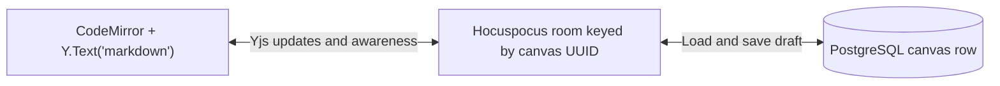

# Markdown canvas collaboration

## Architecture

[CanvasView.tsx](../../../../web/src/modules/canvas/CanvasView.tsx) waits for initial sync, then binds CodeMirror to the room's Yjs text. The browser connects to `/api/collaboration` on the API server. In [canvas-collaboration.ts](./canvas-collaboration.ts), Hocuspocus checks the WebSocket origin, authenticates the Better Auth session, and resolves project access. Editors can send document updates. Viewers receive them through read-only connections. Yjs awareness carries participant names, colors, and editor cursors in memory.

## Persistence and recovery

`onStoreDocument` debounces writes by 500 ms, with a two-second maximum debounce. Each save updates these fields together in a single revision-checked write to the [canvas row](../../db/schema/canvases.ts).

| Field          | Purpose                                                       |
| -------------- | ------------------------------------------------------------- |
| `yjs_state`    | Encoded Yjs document, including the IDs needed to merge edits |
| `draft.source` | Plain Markdown returned by the REST API                       |
| `revision`     | Counter used to reject stale draft replacements               |

After PostgreSQL commits, the server sends a `draft:saved:` acknowledgement with the saved Yjs snapshot. The editor shows **Saved** when that snapshot matches its local document. On a write failure, the room retains the draft in memory and the editor offers **Retry save**.

On graceful shutdown, [index.ts](../../index.ts) calls Hocuspocus `destroy()` to flush pending stores before closing PostgreSQL. On the next join, `onLoadDocument` restores `yjs_state`. For older rows without Yjs state, it seeds the room from `draft.source` and persists that initial state before sync. After an abrupt stop, the server recovers the last committed state. Tabs that stay open can merge their pending edits when they reconnect.

## Browser recovery

[IndexedDB](../../../../web/src/modules/canvas/offline-drafts.ts) stores editor drafts by account and canvas ID. **Saved on device** means the browser committed the edits locally. When the canvas page can load during an API outage, it can recover the cached draft for the same unexpired browser session. Yjs merges the cached state into the room on reconnect. Sign-out clears the account's local drafts, and confirmed access loss clears the affected canvas.

## REST compatibility and deployment

[PATCH /api/canvases/:canvasId](./canvas.routes.ts) applies Markdown replacements through the same room. It returns `409` when the supplied revision is stale or the live Markdown differs from the saved draft.

Apply the [Yjs state migration](../../../drizzle/0004_legal_umar.sql) before starting the upgraded API. Forward WebSocket upgrades to the API and run one collaboration server per database, since active rooms live in that process.
